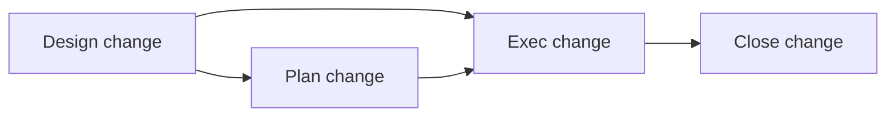

# Explicitly requested change workflow

Apply the [entrypoint scope rules](../SKILL.md#select-the-requested-work). This is one skill with
separate procedures for each requested stage. Read only the stage guidance needed for the task.

## Determine scope

Read the user's request and any named artifact. Check relevant indexes for related current work
when needed. Do not infer that an unrelated Active plan should be resumed just because it exists.

| Request                                                   | Read                                                                                                       | Authorized work                                                                                                            |
| --------------------------------------------------------- | ---------------------------------------------------------------------------------------------------------- | -------------------------------------------------------------------------------------------------------------------------- |
| Design change; draft or update a design doc               | [Design change](design-change.md)                                                                          | Design artifact and its index                                                                                              |
| Plan change; create or update a repository execution plan | [Plan change](plan-change.md)                                                                              | Plan artifact and its index; accept the ready design and update its index                                                  |
| Exec change; implement or resume a named design or plan   | [Exec change](exec-change.md)                                                                              | Implementation within the requested execution scope, current-doc updates, validation, and artifact progress                |
| Report human validation results for an ongoing change     | [Receive human validation results](exec-change.md#receive-human-validation-results)                        | Record evidence, address findings within the authorized scope, and reassess readiness for continuation or close-out        |
| Close change; close or archive a change                   | [Close change](close-change.md)                                                                            | Verify completion, reconcile documentation, and archive eligible records                                                   |
| Draft or update a spec                                    | [Product behavior](#define-product-behavior-when-requested) and [documentation guidance](documentation.md) | Product definition and its index; report open decisions                                                                    |
| Follow the change workflow end to end                     | Relevant stage files above                                                                                 | Requested artifacts, execution within the authorized scope, validation, current-doc reconciliation, and eligible close-out |

Planning is optional. Both routes are supported:

For an end-to-end request, use an execution plan when requested or when the user has delegated
that choice and the work benefits from one. A named design can be executed and closed without a
plan; do not create a plan just to satisfy execution or close-out bookkeeping.

Respect requested stage boundaries and earlier authorization that still applies. Drafting a
spec or design does not authorize implementation. Creating a plan accepts a ready design but does
not grant implementation authority. Execution does not include archival unless close-out is also
authorized. An end-to-end request selects workflow stages; whole-plan execution follows the
[execution scope rules](exec-change.md#execution-scope).
Ask a focused question only when an unresolved decision materially changes the requested outcome.

Read [documentation guidance](documentation.md) for the artifacts being written. Use repository
templates and statuses; use the skill's defaults only when the repository has none. Completion,
review, merge, and release remain separate facts under the skill's shared operating rules.

## Define product behavior when requested

Find an existing spec by feature rather than creating a duplicate for every change. Write its
content using [product-behavior guidance](documentation.md#product-behavior-and-change-history).

In the default layout, use `docs/product-specs/<feature>.md`; living specs have no date prefix.
Update the appropriate Draft/Active/Deprecated index entry and the Last Updated date. A proposed
update to an Active spec must visibly distinguish planned behavior from shipped behavior.

A product spec is useful for new or revised user-facing behavior. An internal change may have no
spec. A user requesting only a design or plan does not implicitly request a new spec.
